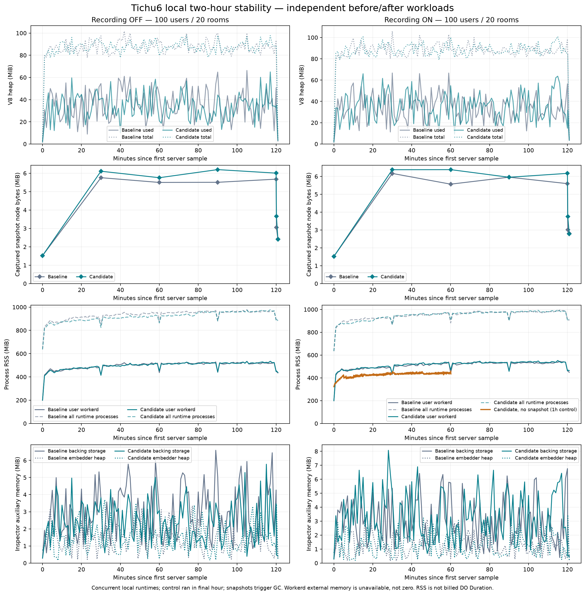

# Long-running stability follow-up

**Completed local validation (2026-11-28) — not merged or deployed.**
Baseline: main `3245b51` (v0.8.47), including PR #5's optimizations. Worktree
`/private/tmp/tichu6-performance`, branch `codex/long-run-stability`.
The unrelated research checkout is unchanged. No production requests, production
load, account metrics, data/configuration changes or plan upgrades are involved.

## Scope and evidence

Four real local Worker/SQLite/WebSocket cases completed at least two hours each:
baseline/candidate × recording disabled/enabled, 100 identities and 20 rooms per
case, five humans plus one bot per room. All run on the same 16-core/64-GiB Mac.
They are independent processes, not a 400-user claim for one lounge. Host
contention and profiling overhead affect timing. A fifth, unprofiled 100-user
candidate/recording-on control ran for one hour during the final hour; it is a
separate profiling-overhead comparison, not another two-hour pass. Random deals are unchanged and
unseeded; compare rates per accepted move and steady overlapping intervals.

Each room loop reconnects its first identity every ten minutes and replaces its
room every fifteen minutes using real forfeit/leave/create/join/start messages.
Round completion continues via the normal `next` action. The forced room churn
is distinguished from a naturally completed match. At the end, twenty clients
reconnect concurrently, all participants leave, and another heap is captured
after 45 seconds. Room recreation is explicit, not deletion of SQLite storage.

There are 100 identities throughout. One baseline/recording-on minute sample
at 600.022 seconds sees 101 open client sockets while a planned same-identity
reconnect overlaps its old socket. All other minute samples see 100; none falls
below 100. This is within the existing 120-socket allowance and is reported, not
dropped from the data. Final identity/seat/reconnect assertions passed.

Minute JSONL includes accepted moves/throughput, response P50/P95/P99/maximum,
logical storage calls/keys/bytes, alarm calls, engine requests, broadcasts,
WebSocket messages/bytes, bot computations, open sockets and memory samples.
`ws.bytes` counts UTF-8 application payloads, not TCP/TLS wire overhead. Sampled
`ps` CPU percentages are not cumulative CPU milliseconds. Raw heaps and local
SQLite contain **synthetic** hands and credentials and stay
outside Git. Only numeric summaries are published.

## Memory definitions and limitations

- `heapUsed` / `heapTotal`: native workerd inspector `Runtime.getHeapUsage`
  used/total V8 sizes. These are not process RSS and not billed DO allocation.
- Workerd's Node compatibility `process.memoryUsage()` returned zeros in all
  fields. Its `external` cannot honestly be measured through that API here;
  report it as unavailable. Inspector `backingStorageSize` and
  `embedderHeapUsedSize` are separate supporting measurements, not substitutes
  with identical semantics.
- Client/collector Node processes report actual `heapUsed`, `heapTotal`,
  `external`, `arrayBuffers` and RSS. Array buffers are included in external;
  never add those two values together. They are load-tool costs, not server heap.
- `ps` samples separate primary workerd, proxy workerd, Wrangler Node and esbuild
  RSS/CPU. RSS can retain allocator high-water marks or mapped/native storage
  after JS is collected. A rising RSS alone is not proof of a JS leak.
- Snapshots at cold start, every 30 minutes, teardown and 45 seconds later provide
  post-collection object graphs. `getHeapUsage` after a snapshot can already
  include allocations from resumed game traffic; it is not the exact retained
  size captured in that graph. Report snapshot node bytes and dominators
  separately from that immediate post-snapshot API reading. Profiling perturbs GC and latency. Inspector
  attachments are short-lived and no remote object handles are retained.
- A first inspector attach can time out while workerd initializes its context;
  warmup/retry happens before the measured workload. Any in-window sampling
  failure is recorded and must be disclosed; counter-epoch resets invalidate
  cumulative comparisons.

### Native memory is a separate measurement

A macOS `vmmap -summary` sample of candidate/recording-on at about 43 minutes
reported a 294.4-MiB physical footprint (334.2-MiB peak), 111.8 MiB allocated in
malloc zones, and 58.0 MiB dirty/swap fragmentation. Large reserved guard regions
had zero resident bytes. Shared library mappings, allocator retention and V8's
reserved space mean neither virtual size nor the sum of mapped resident regions
is equivalent to JS retained heap or `ps` RSS. This one sample identifies native
and allocator overhead; it does not prove a specific native leak or its absence.
The profiler itself contributes overhead. An additional `lsof` sample near 94
minutes found 17 open RoomEngine SQLite databases, rather than one open database
for every previously created room. This is a file-handle count, not attribution
of native bytes or proof about Cloudflare's runtime. No production memory was
inspected.

## Confirmed causes and fixes

### Historical measurement retained actors

PR #5's fixture added a one-hour no-op timer to every measured actor, kept all
seen room IDs, and queried those engines on each metrics read. This prevented
normal eviction and reactivated retired rooms. It was test-only code, not a
production timer. The previous 30-minute RSS trend cannot establish a production
leak.

A 75-second real Worker A/B pilot with 100 clients, 40 reconnects and 20 room
replacements retained **40 RoomEngine instances** after teardown and after
another 45 seconds with the old instrumentation. The new fixture retained 20
immediately after teardown and **zero after 45 seconds**. Both released native `workerd / WebSocket` objects after closing clients.
The two ordinary `WebSocket` constructor/prototype objects are not live sockets. A separate Node ownership regression created
300 states, 300 sockets and 300 engines and collected all of them after release.

The fixture now uses bounded isolate counters, no timer and no retired-ID
registry. DO eviction no longer erases counters; an isolate change is detected
through an epoch. Metrics reads do not reactivate room engines. Sampling timers
exist in the external load process only. Production hibernation logic is unchanged. The load client also removes replaced
client objects from its registry after reconnect, instead of retaining closed
WebSockets and their previous state for the entire experiment. Its finite
latency sample array is load-tool memory, not server memory.

### Unnecessary durable policy writes

Every RoomEngine bot query persisted a `last` result even though `botAction`
is a deterministic, read-only policy calculation. This also overwrote the last
randomized deal/action result merely to store a suggestion.

The candidate gives policy queries one volatile cache entry keyed by the full
input digest and policy version. Restart recomputes exactly the same suggestion.
Actual accepted action/deal results still commit to SQLite before return, and
the Lounge still atomically persists changed game/training data before broadcast.
The durable transition result now survives intervening policy queries. Error
and uncertain-commit retries remain covered. No state-save interval was relaxed.

The 24-hour durable retention of actual transitions is unchanged. Read-only
queries no longer create/refresh durable policy-result retention. This may leave
a larger _last transition_ on disk than an old tiny bot suggestion; retained
storage is measured separately from writes and in-memory actor lifetime.

### Training allocation pressure

Appending a decision previously deeply cloned the entire bounded archive for
rollback, including all old immutable card/public-state objects. The new backup
copies only session containers and event arrays, the parts that append/retention
can mutate. Rollback restores the exact prior content. Pruning allocates a new
session array only when something has expired.

An alternating-order, five-repeat deterministic 2,000-decision benchmark (the
same prepared grand-decision shape, varying revision/session) produced
identical archive SHA-256 in both implementations. Median append workload time
was 153.7 ms before and 74.2 ms after on this host. This is a training-only
microbenchmark, not total game throughput or Cloudflare CPU billing.

The 80-KiB cap, seven-day retention, event/session limits, validation, consent,
exports and `training-v1` durable format are unchanged. Partitioning training
into per-event keys would add index/deletion writes and complicate atomic
migration/rollback; it is not assumed to reduce billed rows merely by reducing
serialized bytes. Accepted records are not deferred or dropped to save writes. The recording-on
soaks still serialized about 3.9 GB cumulatively to `training-v1` over two hours
(3,893,097,310 before / 3,873,540,687 after), repeatedly replacing the bounded
value. This patch reduces allocation pressure, not that storage unit's byte
amplification. A chunk/event migration is a follow-up; it must preserve outcomes,
retention and atomicity while accounting for extra index/key writes.

### Identity churn is retained security state, not an orphaned socket

Disconnected identities retain their last accepted activity timestamp for 24
hours. This prevents an automatic reconnect from resetting the idle deadline.
The map therefore grows with **distinct identities seen in the last day**, not
only the 100 simultaneously connected users. Removing entries on disconnect
would weaken the existing idle/reconnect behavior and is intentionally avoided.
A regression verifies retention up to the boundary, expiry at 24 hours and
absence after persistence/reconstruction. A separate 1,000-distinct-identity
local experiment completed 50 batches of 20 identities over approximately ten
minutes. Every batch returned to zero native sockets and rooms. The serialized
Lounge value grew to 81,025 bytes; its repository data dominated about 152,740
heap bytes and the saved JSON string another 81,040 bytes. After test-only clock
aging beyond 24 hours and normal cleanup, activity returned to zero, the stored
value to 26 bytes, and the idle Lounge was evicted from the heap. Post-snapshot
V8 used size fell from 1,651,524 to 1,345,344 bytes (includes runtime differences,
not an exact per-record attribution). Clock aging is not a claim of a real
24-hour elapsed test and is confined to a disposable fixture.

## Changed files

| Files                                                                            | Purpose                                                                         |
| -------------------------------------------------------------------------------- | ------------------------------------------------------------------------------- |
| `server/game/room-engine.ts`                                                     | Separate pure bot queries from durable transitions; one disposable cache entry  |
| `server/training/records.ts`                                                     | Copy only mutable rollback containers; avoid unchanged prune allocation         |
| `tests/room-engine.test.js`, `tests/stability.test.js`, `tests/lounge.test.js`   | Retry/purity, archive rollback and activity expiry/reconstruction regressions   |
| `scripts/performance/prepare.mjs`, `load.mjs`, `run.mjs`, `soak.mjs`, `heap.mjs` | Local-only lifecycle churn, unbiased counters and minute heap/process sampling  |
| Other `scripts/performance` analysis/retention tools                             | Numeric summaries, graphs, deterministic archive comparison, identity/GC checks |
| `.github/workflows/verify.yml`                                                   | Run the explicit-GC ownership regression in CI                                  |
| Performance/status documents and sanitized artifacts                             | Reproducible evidence and remaining risks                                       |

## Completed measurements

All numbers below are local observations unless explicitly modeled. Recording is on/off for all synthetic users in each case.

| Case            | Seconds | Accepted play/pass | Actions/s | P50 / P95 / P99 / Max (ms)       | Room replacements | Reconnects in window |
| --------------- | ------- | ------------------ | --------- | -------------------------------- | ----------------- | -------------------- |
| Baseline / off  | 7200.9  | 42,022             | 5.836     | 21.86 / 63.08 / 229.41 / 2305.84 | 140               | 220                  |
| Baseline / on   | 7201.0  | 42,284             | 5.872     | 21.84 / 63.98 / 236.01 / 2407.18 | 140               | 220                  |
| Candidate / off | 7201.0  | 42,200             | 5.860     | 21.84 / 63.35 / 213.35 / 2459.37 | 140               | 220                  |
| Candidate / on  | 7201.0  | 42,053             | 5.840     | 21.84 / 64.02 / 213.90 / 2398.11 | 140               | 220                  |

Each case additionally passed 20 simultaneous reconnects after the timed window and then removed all rooms/closed all clients. Response measurements include the harness's 20-ms polling delay; the final pooled latency also includes teardown actions. They are not pure server CPU times. Natural full-match completion is not counted separately from forced forfeit/recreation.

| Counter             | Baseline / off | Baseline / on | Candidate / off | Candidate / on |
| ------------------- | -------------- | ------------- | --------------- | -------------- |
| storage.get         | 2,505          | 2,361         | 2,389           | 2,477          |
| storage.put         | 124,664        | 125,742       | 115,741         | 115,047        |
| storage.delete      | 0              | 0             | 0               | 0              |
| storage.deleteAll   | 0              | 0             | 0               | 0              |
| write.lounge        | 53,604         | 53,940        | 53,972          | 53,704         |
| write.training-v1   | 0              | 50,132        | 0               | 49,879         |
| write.last          | 71,060         | 71,802        | 61,769          | 61,343         |
| storage.getAlarm    | 2,505          | 2,361         | 2,389           | 2,477          |
| storage.setAlarm    | 43,723         | 44,097        | 44,587          | 44,008         |
| storage.deleteAlarm | 0              | 0             | 0               | 0              |
| engine.requests     | 71,060         | 71,802        | 71,814          | 71,228         |
| alarm.fired         | 751            | 783           | 784             | 765            |
| broadcast           | 53,604         | 53,940        | 53,972          | 53,704         |
| ws.messages         | 1,495,437      | 1,512,204     | 1,511,553       | 1,495,363      |
| ws.bytes            | 6,239,597,573  | 6,308,618,986 | 6,308,194,793   | 6,229,496,174  |
| bot.compute         | 9,847          | 10,051        | 10,054          | 9,892          |

| Recording | Before keys/action | After keys/action | Additional reduction | setAlarm/action before → after |
| --------- | ------------------ | ----------------- | -------------------- | ------------------------------ |
| off       | 2.9666             | 2.7427            | 7.55%                | 1.0405 → 1.0566                |
| on        | 4.1594             | 3.9219            | 5.71%                | 1.0429 → 1.0465                |

This is an additional reduction against already-optimized main, **not** a percentage to add to PR #5's historical 29.5%. Different random deals and corrected instrumentation prevent a direct cumulative claim. Alarm savings from PR #5 remain; this patch does not claim a further large alarm reduction.

### Memory and teardown

| Case            | Snapshot node MiB at 30 / 60 / 90 / 120 min | After 45s teardown MiB | Remaining engines | Remaining native sockets |
| --------------- | ------------------------------------------- | ---------------------- | ----------------- | ------------------------ |
| Baseline / off  | 5.757 / 5.498 / 5.506 / 5.677               | 2.423                  | 0                 | 0                        |
| Baseline / on   | 6.169 / 5.568 / 5.959 / 5.596               | 2.805                  | 0                 | 0                        |
| Candidate / off | 6.108 / 5.756 / 6.196 / 6.004               | 2.408                  | 0                 | 0                        |
| Candidate / on  | 6.377 / 6.381 / 5.954 / 6.173               | 2.783                  | 0                 | 0                        |

At candidate/recording-on's 120-minute snapshot, the component estimates were:

| Component                          | Count | Dominated bytes (group sum) |
| ---------------------------------- | ----- | --------------------------- |
| Live RoomEngine instances          | 16    | 844,792                     |
| Engine durable-result cache        | 16    | 838,212                     |
| Engine volatile policy cache       | 16    | 2,612                       |
| Authoritative trick-history arrays | 20    | 385,968                     |
| Score-history arrays               | 20    | 3,792                       |
| Game-log arrays                    | 20    | 7,152                       |
| Training archive                   | 1     | 77,516                      |
| Activity map                       | 1     | 4,316                       |
| Snapshot WeakMap container         | 1     | 2,084                       |
| Bot WeakMap container              | 1     | 2,084                       |
| Native WebSocket graph nodes       | 100   | 73,590                      |
| JS Timeout instances               | 0     | 0                           |

These groups overlap; do not sum them. WeakMap container estimates do not fully
attribute ephemeron values, and native socket graph nodes exclude unexposed
runtime buffers. The separate explicit-GC regression tests released cache keys.
All live engines and native sockets disappeared after teardown. Records needed
for reconnect/retention remain durable and are not mistaken for leaked actors.



| Case            | User workerd RSS range MiB | Final RSS MiB | Sampled %CPU range | Peak training JSON bytes | SQLite retained value bytes | Stored keys |
| --------------- | -------------------------- | ------------- | ------------------ | ------------------------ | --------------------------- | ----------- |
| Baseline / off  | 199.1–534.0                | 434.5         | 0.1–40.7           | 15                       | 887,785                     | 162         |
| Baseline / on   | 199.6–545.3                | 448.6         | 0.2–45.3           | 81,897                   | 576,317                     | 162         |
| Candidate / off | 199.6–534.5                | 438.1         | 0.1–39.3           | 15                       | 4,894,796                   | 162         |
| Candidate / on  | 199.3–552.3                | 463.9         | 0.0–48.9           | 81,911                   | 4,934,345                   | 162         |

RSS sums are not unique physical memory; shared mappings can be counted in several processes. Stored value bytes exclude SQLite metadata; local DB/WAL file bytes remain in the JSON evidence and are not billed storage directly.

The one-hour unprofiled control completed 3,601 seconds and 20,926 actions,
with the same teardown/reconnect checks. Its sampled user-workerd RSS ranged
322.5–459.1 MiB and ended at 434.5 MiB. It also warmed up and retained allocator
memory without heap snapshots. The lower RSS than profiled runs is consistent
with profiler overhead, but random workloads/timing prevent attributing the
entire difference to profiling. No unbounded JS retained-object trend was
observed in these two-hour cases; this is **not a six-hour or indefinite proof**.

The candidate's retry records retain 4.9 MB of values across 162 keys versus
0.58–0.89 MB before. This is a bounded, 24-hour durability tradeoff, not memory
held by deleted actors: all RoomEngine objects were collected. Using the same
observed room/value sizes over a modeled 24-hour churn day gives roughly 52 MB
of retained values before SQLite metadata; the cost model still assumes total
account storage below 5 GB. Do not infer billed storage from local WAL sizes.

### Short cost calibration cases

| Users | Case            | Actions | Actions/s | P95 ms | Data keys/action |
| ----- | --------------- | ------- | --------- | ------ | ---------------- |
| 20    | Candidate / off | 186     | 1.547     | 22.69  | 2.548            |
| 20    | Baseline / off  | 191     | 1.587     | 22.72  | 2.759            |
| 20    | Candidate / on  | 194     | 1.612     | 22.69  | 3.510            |
| 20    | Baseline / on   | 181     | 1.505     | 22.65  | 3.873            |
| 50    | Candidate / off | 415     | 3.451     | 22.84  | 2.441            |
| 50    | Baseline / off  | 427     | 3.530     | 22.80  | 2.672            |
| 50    | Candidate / on  | 424     | 3.520     | 22.76  | 3.514            |
| 50    | Baseline / on   | 405     | 3.370     | 22.71  | 3.756            |

## Regression coverage

- Full suite: **186 unit + 112 UI tests passed** (298 total); ESLint, frontend/server type checks, formatting and production build passed.
- Existing rule/scoring, auth/privacy, count/reconnect and UI regressions.
- Policy purity/determinism across grand, exchange, play and trick phases;
  engine reconstruction without a policy write or alarm; original deal retry
  after an intervening policy query.
- Uncertain committed-write failure and repository dirty-marker retry remain
  covered by existing tests.
- Training rollback after byte-cap eviction, identical serialized archive on a
  shared decision stream, preservation of immutable decision objects.
- Explicit-GC ownership regression for weak state/socket caches and released
  engines; this runs in CI as a separate Node check.
- Real local Worker admission/privacy/bots, idle/expiry, game-flow and full
  SQLite process-restart recovery suites.

## Cost method

Official sources checked 2026-11-28:
[DO pricing](https://developers.cloudflare.com/durable-objects/platform/pricing/),
[Workers pricing](https://developers.cloudflare.com/workers/platform/pricing/),
and [DO limits](https://developers.cloudflare.com/durable-objects/platform/limits/).

The report separates **measured API calls/logical key writes**, a **code-based
SQLite row proxy** (keys, alarms and separately modeled retention cleanup), and
**actual billed rows**, which are not available from this local test. KV methods
use SQLite rows; do not apply legacy KV 4-KiB write units. setAlarm writes a row;
deletions also count. API call counts and serialized bytes are not billing units.

Before/after costs are normalized to the same baseline accepted-play/pass rate
within each user-count/recording scenario. Fixed reconnect/room-churn rates use
the baseline schedule for both. This removes throughput-count differences from
the comparison; it does not claim identical random deals or action sequences.

Daily activity scenarios are 2/24 hours for 20/50/100 users, recording both off
and on, over a 30-day month. The 20/50-user runs are 120-second steady workloads;
100-user cases include churn/reconnect. The timed counters start after initial
admission/deal/exchange; daily projections describe that measured activity rate
and include in-window room recreation, not an exact fresh-start invoice. Initial
setup writes, hidden SQLite metadata and production-specific behavior add an
unmeasured margin. The displayed free-limit crossing is therefore a model, not
permission to operate precisely at that boundary. Include expected post-24-hour engine
cleanup separately rather than claiming it was observed during two hours.

Duration remains a scenario at 1%, 10% and 100% active duty per Lounge/room,
0.128 GB each; local wall time is never called Cloudflare Duration. Paid starts
at $5/month; excess dimensions round up to documented billing units. Storage
below 5 GB-month and Worker upgrade traffic/CPU within included quotas are
explicit assumptions. Other account use/taxes are excluded. Free quota excess
rejects operations; it does not automatically purchase Paid service.

## Modeled daily usage and monthly costs

The following tables normalize both variants to the baseline accepted-play/pass rate for each user/recording scenario, assume no other account usage and exclude unmeasured startup/metadata margin. Arrows mean baseline → candidate; costs are USD for 30 days, with 10% active-duty Duration as a sensitivity example, **not measured billing**.

| Users | Recording | Hours/day | DO request proxy/day | Read row proxy/day | Data keys/day         | Alarm writes/day  | Modeled rows written/day | Paid/month at 10% duty |
| ----- | --------- | --------- | -------------------- | ------------------ | --------------------- | ----------------- | ------------------------ | ---------------------- |
| 20    | off       | 2         | 20,224 → 20,383      | 8 → 8              | 31,531 → 29,122       | 7,898 → 8,479     | 39,436 → 37,609          | $5.00 → $5.00          |
| 20    | off       | 24        | 242,378 → 244,285    | 8 → 8              | 378,370 → 349,465     | 94,772 → 101,743  | 473,149 → 451,217        | $6.05 → $6.05          |
| 20    | on        | 2         | 19,422 → 18,605      | 128 → 120          | 41,953 → 38,025       | 9,037 → 7,315     | 50,998 → 45,348          | $5.00 → $5.00          |
| 20    | on        | 24        | 232,752 → 222,953    | 1,444 → 1,348      | 503,439 → 456,303     | 108,444 → 87,776  | 611,891 → 544,087        | $5.90 → $5.90          |
| 50    | off       | 2         | 41,699 → 41,458      | 734 → 1,490        | 67,919 → 62,043       | 21,429 → 19,660   | 89,368 → 81,724          | $5.15 → $5.15          |
| 50    | off       | 24        | 499,624 → 496,724    | 8,592 → 17,659     | 815,030 → 744,521     | 257,152 → 235,924 | 1,072,202 → 980,465      | $7.10 → $7.10          |
| 50    | on        | 2         | 39,922 → 39,450      | 1,218 → 1,393      | 91,117 → 85,260       | 21,686 → 20,771   | 112,823 → 106,051        | $5.15 → $5.15          |
| 50    | on        | 24        | 478,298 → 472,627    | 14,397 → 16,500    | 1,093,402 → 1,023,119 | 260,231 → 249,256 | 1,353,653 → 1,272,395    | $7.10 → $7.10          |
| 100   | off       | 2         | 74,863 → 75,347      | 5,329 → 5,077      | 124,648 → 115,238     | 43,717 → 44,393   | 168,685 → 159,951        | $5.30 → $5.30          |
| 100   | off       | 24        | 896,816 → 902,624    | 63,512 → 60,486    | 1,495,772 → 1,382,852 | 524,607 → 532,717 | 2,023,778 → 1,918,969    | $32.40 → $29.55        |
| 100   | on        | 2         | 75,649 → 75,456      | 5,041 → 5,300      | 175,849 → 165,808     | 44,091 → 44,243   | 220,259 → 210,372        | $5.30 → $5.30          |
| 100   | on        | 24        | 906,246 → 903,935    | 60,055 → 63,166    | 2,110,186 → 1,989,699 | 529,088 → 530,921 | 2,642,674 → 2,524,019    | $51.55 → $47.55        |

| Users | Hours/day | Duration GB-s/day at 1% / 10% / 100% duty | Duration-only monthly surcharge at same duties |
| ----- | --------- | ----------------------------------------- | ---------------------------------------------- |
| 20    | 2         | 46 / 461 / 4,608                          | $0.00 / $0.00 / $0.00                          |
| 20    | 24        | 553 / 5,530 / 55,296                      | $0.00 / $0.00 / $25.00                         |
| 50    | 2         | 101 / 1,014 / 10,138                      | $0.00 / $0.00 / $0.00                          |
| 50    | 24        | 1,217 / 12,165 / 121,651                  | $0.00 / $0.00 / $50.00                         |
| 100   | 2         | 194 / 1,935 / 19,354                      | $0.00 / $0.00 / $12.50                         |
| 100   | 24        | 2,322 / 23,224 / 232,243                  | $0.00 / $12.50 / $87.50                        |

| Users | Recording | Modeled Free write limit before → after | Modeled Free request limit before → after |
| ----- | --------- | --------------------------------------- | ----------------------------------------- |
| 20    | off       | 5.07h → 5.32h                           | 9.90h → 9.82h                             |
| 20    | on        | 3.92h → 4.41h                           | 10.31h → 10.76h                           |
| 50    | off       | 2.24h → 2.45h                           | 4.80h → 4.83h                             |
| 50    | on        | 1.77h → 1.89h                           | 5.02h → 5.08h                             |
| 100   | off       | 1.19h → 1.25h                           | 2.67h → 2.66h                             |
| 100   | on        | 0.91h → 0.95h                           | 2.64h → 2.65h                             |

Free Duration reaches 13,000 GB-s after approximately 5.64h / 2.56h / 1.34h for 20 / 50 / 100 users at 100% active duty; multiply those times by ten at 10% duty. The first exhausted dimension wins. Storage must also stay under the account's 5-GB cap. These are budget-crossing estimates, not safe operating guarantees.

Detailed reads, retention-cleanup assumptions, storage values, all fee dimensions and 1%/10%/100% total cost scenarios are in [numeric results](stability-results.json). [Supplemental evidence](stability-supplement.json) covers the identity/GC/pilot/archive tests; [heap summaries](stability-retainers.json) contain only numeric object statistics.

### Practical Free-plan interpretation

Under this measured workload and no other account use, **20 users for two hours**
fit the modeled write/request/Duration limits; **50 users for two hours with
recording off** fit but leave less write headroom. Recording on at 50 users, or
100 users for two hours, exceed the modeled daily write allowance. Sustained
24-hour play exceeds Free writes in all three sizes. Actual human pace, initial
setup, hidden rows and other account usage change these boundaries. No plan was
changed. The approximately 5.2% (recording off) / 4.5% (on) reduction in the
modeled write-row proxy is smaller than the 7.55% / 5.71% data-key reduction
because alarms remain a separate cost.

## Remaining risks and follow-up

1. **P1 — history growth.** Full trick/score history grows for the lifetime of a match. This is intended
   retained product data, not automatically a cache leak. Very long matches can
   increase clone/serialization cost and eventually reach the internal 4-MiB
   engine request or aggregate storage-value bounds. Do not truncate history or
   change scoring/match termination silently. Cold history storage or immutable
   history sharing needs a separate preservation/migration design.
2. **P1 — transactional room storage.** The authoritative Lounge still serializes all rooms and commits one key.
   Dirty per-room records require a transaction/migration design, not a debounce.
   Actual transition-result writes are intentionally retained: unlike a pure
   policy suggestion, deals and time-sensitive actions need retry-safe results
   before the coordinator acknowledges the durable game state. Removing this
   layer requires a reviewed ownership/commit protocol, not another cache flag.
3. **P1 — longer native-memory validation.** Native/runtime memory and physical Cloudflare billing/hibernation efficiency
   cannot be proved by local JS heaps. Repeated-day and production telemetry need
   separate authorization. A two-hour pass is not a six-hour or indefinite claim.
4. **P1 — identity-turnover bounds.** Distinct-identity activity tombstones are time-bounded but not count-bounded
   by the connected-user cap. High identity turnover can grow the single Lounge
   value for 24 hours. Separate expiry-indexed records or admission protection
   need a security-preserving design; do not evict timestamps just to lower heap.
5. **P2 — policy contract.** Pure-query caching depends on deterministic policy inputs; future randomness,
   clocks or policy changes must preserve or deliberately revise that contract.
6. **P2 — retention/account telemetry.** Actor cleanup does not imply immediate deletion of the 24-hour retry record.
   SQLite files/WAL are local implementation storage, not billed bytes directly.

## Rollback

No schema or configuration migration is introduced. Revert the candidate server
commits and keep existing `lounge`, `training-v1` and `last` values. The previous
binary can read them. Never erase room storage as rollback. Local profiling
scripts are not imported by the production entry point and must not be deployed.

## Local reproduction

Use a clean copy of baseline `3245b51` and a separate candidate checkout. Never
point these tools at production. `prepare.mjs` only creates disposable `/tmp`
fixtures. Each soak needs fresh output/state and distinct ports:

```sh
node scripts/performance/prepare.mjs . /tmp/tichu-candidate-fixture
PERF_CONSENT=false node scripts/performance/soak.mjs /tmp/tichu-candidate-fixture /tmp/tichu-candidate-off 8902 9343
# Repeat with PERF_CONSENT=true, a fresh fixture/output and other ports.
node --expose-gc scripts/performance/retention.mjs
```

The collector locates native workerd's inspector via `ps`/`lsof` on macOS.
Inspected `external` memory is unavailable in this runtime; no zero-valued Node
compatibility field is treated as a real measurement. Numeric postprocessing:

```sh
node scripts/performance/stability-summary.mjs /tmp/tichu-stability-results docs/stability-results.json
uv run --project scripts/performance --locked python scripts/performance/analyze_heap.py /tmp/tichu-stability-results/{baseline-off-v2,baseline-on-v2,candidate-off,candidate-on}/heap-*.heapsnapshot > docs/stability-retainers.json
uv run --project scripts/performance --locked python scripts/performance/plot_stability.py docs/stability-results.json docs/stability-memory.png
```

The Python analysis scripts use the managed `scripts/performance/pyproject.toml`/`uv.lock` environment. Dominator
summaries exclude weak edges and may overlap between groups; native/ephemeron
reachability differs from Chrome DevTools' exact retained-size accounting.
Raw heap snapshots, SQLite files and synthetic credentials must stay out of Git.

For the separate identity experiment, generate another fresh temporary fixture
with `PERF_IDENTITY_EXPIRY=1`, start it with `wrangler dev --local` on port 8916,
and run `node scripts/performance/identity-churn.mjs`. After all clients close,
its **local-only** `/__expireActivity` endpoint ages only synthetic activity
entries and invokes normal cleanup/persistence. This opt-in endpoint does not
exist in the production worker. The unit regression independently tests the
24-hour boundary and reconstruction without such an endpoint.

The unprofiled control uses the same candidate fixture with
`PERF_CASES=100 PERF_SECONDS=3600 PERF_CONSENT=true PERF_CHURN=1 PERF_CLEANUP=1`
and `scripts/performance/run.mjs`, writing to the `no-profiler-control` result
subdirectory on separate local ports. The summary script requires this control
and all four completed two-hour cases; it refuses to publish incomplete runs.

## Review and release handling

The branch stays separate from main, with no version bump, production requests
or deployment. Review commits use the documented
[`[CF-Pages-Skip]` prefix](https://developers.cloudflare.com/pages/configuration/git-integration/github-integration/)
to suppress Pages builds. The repository's only workflow verifies code; it does
not deploy the Worker. Any later merge/release still requires user approval.
